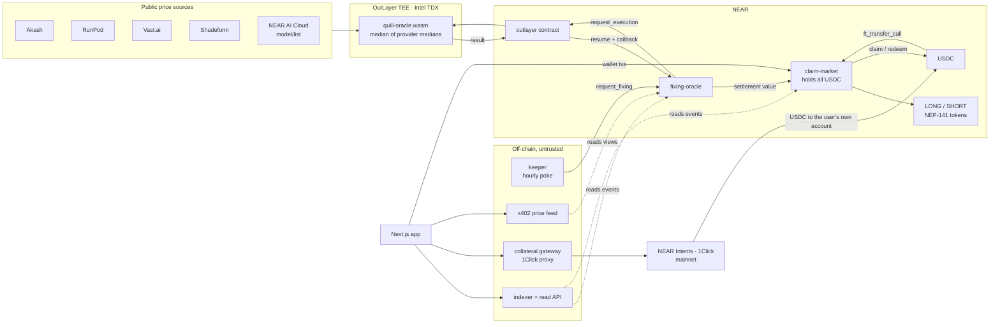
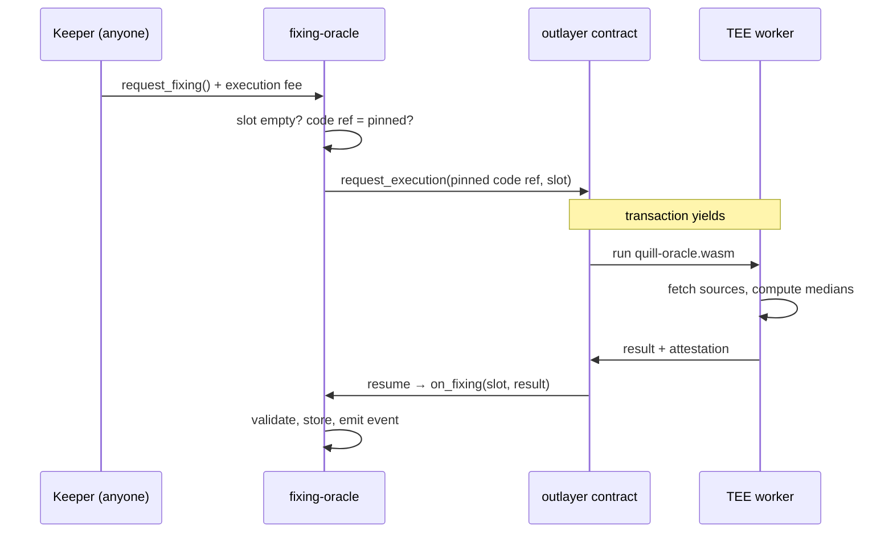

# Quill backend architecture

Quill is a fully-collateralized market for the price of AI compute on NEAR. This document says where the money sits, who can move it, how the price gets on-chain, and what happens when each part fails.

Status: design, 11 Nov 2026. Items marked **VERIFY** are assumptions to confirm before building on them (section 11).

## 1. Five rules the design follows

1. **Money lives in one contract, and two functions move it out.** USDC only ever leaves `claim-market` through `redeem_pair` (before expiry) and `claim` (after settlement). There is no admin withdrawal.
2. **No operator in the money path.** Requesting a fixing, settling a market and claiming are all permissionless calls. We run a keeper for convenience; anyone else can run one.
3. **Off-chain services are caches.** If our API, indexer and website all go down, a user can still redeem and claim with `near-cli`.
4. **The oracle code is pinned per market.** A market stores the exact oracle code reference it will settle on. Nobody, including us, can change it for a market that already exists.
5. **One command reproduces everything.** `make demo` deploys to a local sandbox, mints, fixes, fast-forwards, settles and claims, with assertions.

## 2. System map



## 3. Components

| Component | Runs on | Trusted with funds? | Job |
|---|---|---|---|
| `claim-market` | NEAR contract (Rust) | Yes: the only custodian | Mint pairs, redeem pairs, settle, pay claims |
| `fixing-oracle` | NEAR contract (Rust) | No funds; trusted for the price | Request fixings, validate callbacks, store history, compute the settlement average |
| `quill-oracle` | WASI program in OutLayer's TEE | No funds | Fetch sources, compute the index, return value + inputs hash |
| LONG / SHORT tokens | NEP-141 contracts, one pair per market | Mint/burn by `claim-market` only | Transferable claims, tradable on any venue |
| Keeper | Any cron host | No | Calls `request_fixing` hourly and `settle` after expiry |
| Indexer + read API | Node service + SQLite/Postgres | No | Turns contract events into fast queries for the UI |
| Collateral gateway | Node service | No: never holds funds | Proxies 1Click quotes and status so the JWT stays server-side |
| x402 feed | Node service | No | Sells the attested fixing per read; revenue tops up the keeper |

## 4. The oracle

This is the part that separates Quill from the earlier compute markets, which ran their oracle workflow in simulation.

### 4.1 What runs in the enclave

`quill-oracle` is a Rust program compiled to WASM (WASI). One execution computes every index, so cost does not grow with the number of markets.

For each GPU index (H100, B200):

1. Fetch listings from each provider over TLS with a timeout. A provider that fails is skipped.
2. Keep on-demand listings for the exact GPU model; normalise to USD per GPU-hour (divide multi-GPU offers by GPU count).
3. Drop listings outside 0.4× to 2.5× of the previous fixing (obvious typos and bait listings).
4. Take the **median per provider**, so a provider with 500 listings counts the same as one with 20.
5. Require at least 3 providers. Providers that list individual offers (Vast.ai, Shadeform) must have at least 5 listings to count; RunPod and Akash publish their own aggregated figures and count as given. Otherwise report "no fixing" for that index.
6. The index is the **median of the provider medians**.

For the inference index (INF-OUT): read `outputCostPerToken` for the pinned model from `cloud-api.near.ai/v1/model/list` and convert to USD per 1M tokens. It is a single first-party source, stated as such.

Output (compact, under the callback size limit):

```json
{"slot": 490334, "v": {"H100": 3060000, "B200": 7020000, "INF_OUT": 600000},
 "n": {"H100": 4, "B200": 3, "INF_OUT": 1}, "inputs": "sha256:b81d…04cf"}
```

Values are integers in micro-USD. `slot` is the Unix hour. `inputs` is the SHA-256 of the canonical JSON of every provider median, listing count and fetch time. The program also publishes that readings bundle (best-effort) so anyone can recompute the hash; the `/proof` feed endpoint serves it.

### 4.2 How a fixing gets on-chain



`request_fixing` is permissionless and pays the OutLayer fee from the caller's deposit. `fixing-oracle` builds the OutLayer request itself from its stored, immutable code reference (repository + commit, or WASM hash). A caller cannot substitute different code or inputs.

### 4.3 What the contract checks in the callback

- The callback is private: only the contract's own promise chain from OutLayer can reach it.
- `slot` equals the slot requested and that slot is still empty (one fixing per index per hour).
- `n >= 3` for GPU indexes.
- The value is within 50% of the median of the last 6 fixings. A value outside is stored as `flagged` and excluded; three flagged values in a row in the same direction are accepted (a real regime change), so the oracle cannot be frozen by one honest jump.
- The stored record keeps `value`, `n`, `inputs`, the code reference and whatever attestation fields OutLayer returns.

**Trust statement, plainly:** the on-chain root of trust is the OutLayer contract plus Intel TDX. Quill does not verify a TDX quote itself. The enclave proves our pinned code produced the number from what the sources returned over TLS. It does not prove a list price is what a buyer would really pay.

### 4.4 The settlement value

A market does not settle on one reading. `settlement_value(index, expiry)` is the arithmetic mean of the hourly fixings in the 24 hours before expiry.

| Situation | Rule |
|---|---|
| 18 or more of the 24 fixings exist | Use their mean |
| Fewer than 18 | The window extends forward hour by hour until 18 exist, for up to 72 hours |
| Still fewer than 18 after 72 hours | Anyone may call `settle_fallback`: mean of all fixings in the 7 days before expiry |
| No fixing at all in those 7 days | Market is void: every LONG and every SHORT redeems for half the band |

Every branch is callable by anyone and needs no decision from us.

### 4.5 Fallback oracle (if the TEE path cannot ship)

Mode B: `on_fixing` is replaced by `submit_fixing(payload, signatures)`, accepted when N of M registered ed25519 keys signed the same payload (`env::ed25519_verify`). Same payload, same validation, same settlement rules. It is described to users as "signed by N independent reporters", never as attested.

### 4.6 Cost and liveness

- One execution per hour covers all indexes: 24 executions a day. At the documented 0.1 NEAR per execution that is 2.4 NEAR a day. **VERIFY** the current fee.
- Feed revenue is paid to the keeper account, so reads fund fixings.
- `/health` on the read API reports the age of the last fixing; the keeper alerts if it exceeds 2 hours.

## 5. Contracts

### 5.1 `fixing-oracle`

```rust
#[payable] fn request_fixing(&mut self) -> Promise;                 // anyone
#[private] fn on_fixing(&mut self, slot: u64, #[callback_result] r: Result<String, PromiseError>);
fn latest(&self, index: IndexId) -> Option<Fixing>;                 // view
fn fixing_at(&self, index: IndexId, slot: u64) -> Option<Fixing>;   // view
fn settlement_value(&self, index: IndexId, expiry_slot: u64) -> Settlement; // view: Ready(v) | Waiting | Fallback(v) | Void
fn code_ref(&self) -> String;                                       // view, set once at init
```

### 5.2 `claim-market`

```rust
fn create_market(&mut self, index: IndexId, floor: U128, cap: U128, expiry_slot: u64) -> MarketId; // permissionless + storage deposit
fn ft_on_transfer(&mut self, sender_id: AccountId, amount: U128, msg: String) -> PromiseOrValue<U128>; // msg = {"mint": market_id}
fn redeem_pair(&mut self, market: MarketId, units: U128) -> Promise; // burns 1 LONG + 1 SHORT per unit, before or after expiry
fn settle(&mut self, market: MarketId) -> Promise;                  // anyone, after expiry; reads fixing-oracle once
fn claim(&mut self, market: MarketId, side: Side) -> Promise;       // burns caller's tokens, pays USDC
fn market(&self, id: MarketId) -> MarketView;                       // view
```

A market's `index`, `floor`, `cap`, `expiry_slot`, oracle account and oracle `code_ref` are written once at creation and never change.

**Units.** USDC has 6 decimals. Prices are micro-USD. LONG and SHORT have 6 decimals; 1.000000 token is a claim on one unit (one GPU-hour, or one million tokens). `width = cap - floor`.

| Step | Formula (integers) | Rounding |
|---|---|---|
| Mint `q` token units | `locked = ceil(q × width / 1e6)`; any excess deposit is refunded by `ft_on_transfer`'s return value | Up, in the contract's favour |
| LONG payout | `floor(q × (clamp(S, floor, cap) − floor) / 1e6)` | Down |
| SHORT payout | `floor(q × (cap − clamp(S, floor, cap)) / 1e6)` | Down |

Rounding dust (under one micro-USDC per claim) stays in the contract. It can never be withdrawn by anyone, which keeps rule 1 simple.

**Invariants** (asserted in unit tests and property tests):

1. LONG supply equals SHORT supply for every market, always.
2. USDC held ≥ Σ over markets of `ceil(supply × width / 1e6)` before settlement.
3. Total paid by `claim` + `redeem_pair` for a market ≤ USDC locked for it.
4. After `settle`, the settlement value never changes.
5. No function other than `redeem_pair` and `claim` transfers USDC out.

### 5.3 Token model

`claim-market` deploys two minimal NEP-141 contracts per market through a factory (`<market>-long.<claim-market>`, `<market>-short.<claim-market>`); only `claim-market` can mint or burn. Standard tokens mean any venue can list them (a Rhea Classic pool, or anything else).

Cut line if time runs short: keep balances inside `claim-market` as an internal ledger with a built-in fixed-spread swap, and say so. The collateral logic is unchanged.

### 5.4 Events (NEP-297, `standard: "quill"`)

`fixing_requested`, `fixing_stored`, `fixing_flagged`, `market_created`, `minted`, `redeemed`, `settled`, `claimed`. Each carries the ids and integer amounts needed to rebuild every screen from chain data alone.

### 5.5 Async safety on NEAR

Cross-contract calls on NEAR are not atomic, so every outgoing transfer follows one pattern: change state first (burn tokens, reduce locked collateral), send USDC, and in the callback restore the state if the transfer failed. `settle` is idempotent. `ft_on_transfer` returns the unused amount so a rejected mint refunds automatically. Storage is paid by the user (NEP-145).

### 5.6 Who can do what

| Actor | Can | Cannot |
|---|---|---|
| Anyone | Create a market, request a fixing, settle, mint, redeem, claim | Move another account's tokens or USDC |
| Quill team | Run a keeper, the API and the feed | Withdraw USDC, change a market, change the oracle code of an existing market, pause claims |
| OutLayer | Deliver or withhold a result | Move funds; settle a market on its own |

Both contracts are deployed with their full-access keys deleted, so they cannot be upgraded. A new oracle version means a new `fixing-oracle` deployment that only new markets can point to.

## 6. Off-chain services

All TypeScript, one repository, each deployable alone.

### 6.1 Keeper

A cron job: every hour call `request_fixing`; every 10 minutes call `settle` for expired, unsettled markets. Stateless. It holds a key with only enough NEAR for fees.

### 6.2 Indexer and read API

Polls the two contracts' transactions, parses `EVENT_JSON` logs and writes rows to SQLite (Postgres in production). **VERIFY** which indexing source to use (FastNEAR or NearBlocks transaction APIs, or NEAR Lake).

| Endpoint | Returns |
|---|---|
| `GET /markets` | All markets with index now, band, expiry, LONG/SHORT quotes, collateral locked |
| `GET /markets/:id` | One market, its payoff table and 30 days of index history |
| `GET /fixings?index=H100` | Fixing history with inputs hash, code ref and tx |
| `GET /portfolio/:account` | Balances, worth now, range at expiry, claimable |
| `GET /activity/:account` | Mints, trades, claims with tx links |
| `GET /health` | Last fixing age, indexer lag, keeper balance |

Every row carries a transaction hash. The app reads anything that decides money (balances, claimable amounts, the latest fixing) straight from RPC view calls, not from this API, so a compromised API can mislead a display but cannot misstate a payout.

### 6.3 Collateral gateway (NEAR Intents)

`POST /collateral/quote` and `GET /collateral/status` proxy the 1Click API (`/v0/quote` with `EXACT_OUTPUT`, `/v0/status`). The quote's recipient is **the user's own NEAR account** and `refundTo` is their origin wallet, so cross-chain funds are never in Quill's custody. The user then mints with a normal `ft_transfer_call`.

Intents is mainnet-only. On testnet the gateway serves `dry: true` quotes and the app uses test USDC; the live cross-chain leg is shown once on mainnet with a small amount.

### 6.4 x402 price feed

`GET /v1/fixing/:index`, `/history` and `/proof`. Unpaid requests get `402 Payment Required` with the price; paid requests return the fixing read from `fixing-oracle` plus its inputs hash, code ref and transaction. Built on `@fastnear/x402`. **VERIFY** its API. The latest fixing is always free to read from the contract; the feed sells convenience, history and the proof bundle.

### 6.5 Data store

`markets`, `fixings`, `events`, `balances_cache`, `feed_reads`, `oneclick_quotes`. Every table can be dropped and rebuilt from chain.

## 7. Threat model

| Threat | What limits it |
|---|---|
| Someone posts fake cheap or expensive listings on one marketplace | Per-provider median (one provider, one vote), outlier filter, 3-provider minimum, 24-hour average. Moving the settlement means distorting 2 of 4 providers for most of a day. |
| A provider's API lies or goes down | It is one vote of four; below 3 providers there is no fixing, and section 4.4 covers gaps |
| Quill team turns malicious | No fund-moving admin function, no upgrade key, oracle code pinned per market |
| Keeper stops | Anyone can call `request_fixing` and `settle`; liveness rules in 4.4 |
| OutLayer is down or censors | Window extension, then `settle_fallback`, then void at half the band. Funds are never stuck. |
| OutLayer or TDX is compromised | Out of scope to prevent; bounded per market by the band (a holder can gain or lose at most `width` per unit). Stated in the README. |
| Read API or website is compromised | Cannot move funds; money-deciding values are read from RPC; wallet shows the real transaction |
| 1Click swap fails | Intents refunds to the origin wallet; Quill never held the funds |
| Rounding exploited by many tiny mints or claims | Mint rounds up, payouts round down, minimum mint size |
| Failed USDC transfer mid-claim | State restored in the callback (5.5) |
| USDC issuer freezes the contract | Not preventable; stated as a limit |

## 8. Testing and reproducibility

- **Unit and property tests** (Rust, `proptest`): the five invariants over random bands, sizes and settlement values; every settlement branch in 4.4.
- **Sandbox integration** (`near-workspaces`): deploy both contracts and a mock USDC, mock the OutLayer contract, mint, post 24 fixings, fast-forward past expiry, settle, claim both sides, assert balances to the micro-USDC.
- **Oracle tests**: recorded provider responses as fixtures; assert medians, filters, the inputs hash, and the "no fixing" cases.
- **`make demo`**: the full scripted run above in under two minutes with no keys and no network. This is the command the README points the AI screeners to.
- **`make testnet-demo`**: the same flow against testnet with the real OutLayer call.
- CI runs all of it on every push.

## 9. Repository layout

```
contracts/fixing-oracle/     Rust, near-sdk
contracts/claim-market/      Rust, near-sdk (+ token factory)
contracts/mock-usdc/         test only
oracle/                      Rust → WASM (WASI), runs in OutLayer; fixtures/
services/keeper/             TypeScript cron
services/api/                indexer + read API + collateral gateway
services/feed/               x402 price feed
app/                         Next.js, from the design canvas
scripts/demo.sh              what `make demo` runs
ARCHITECTURE.md  README.md  LICENSE
```

## 10. Build order for the three days, with cut lines

| When | Build | Done when |
|---|---|---|
| Tue 11 Nov, night | The two kill-checks: OutLayer round trip into a testnet contract; live price pulls from the four sources and NEAR AI | An OutLayer result is stored on testnet; a median prints from live data |
| Wed 12 Nov | `claim-market` + `fixing-oracle` with all tests; `quill-oracle` with fixtures; `make demo` | `make demo` passes from a fresh clone |
| Thu 13 Nov | Keeper, read API, app screens wired to testnet, collateral gateway with dry quotes, one recorded mainnet deposit | The demo spine runs in a browser |
| Fri 14 Nov | x402 feed, README, screener runs, video, submit | Claude Code and Codex both reproduce the README |

Cut in this order: x402 feed → NEP-141 factory (use the internal ledger) → the indexer (app reads views only) → B200 and INF-OUT UI polish → the live 1Click deposit (keep dry quotes). Never cut: the pinned-code oracle path (or honest Mode B), the invariants and their tests, `make demo`.

## 11. Verify first

| Assumption | Why it matters | If false |
|---|---|---|
| A contract can call `request_execution` on `outlayer.testnet` and receive the result in a callback | The whole oracle path | Mode B (4.5) |
| OutLayer returns attestation fields today (one docs page says "coming soon") | The "attested" wording and the Privacy track | Say "runs in a TEE via OutLayer", drop "attested" and the track |
| Callback results are limited to roughly 900 bytes | Output format | Already compact; trim `n` if needed |
| The request can pin code by commit or WASM hash | Rule 4 | Pin whatever identifier OutLayer supports and store it per market |
| Execution fee is 0.1 NEAR | Keeper cost | Fix hourly → every 2 or 4 hours; average window still 24h |
| `outlayer.near` exists on mainnet | A guarded mainnet deployment | Stay on testnet; state it |
| Vast.ai, RunPod, Akash and Shadeform prices are readable without paid keys and their terms allow it | The index | Drop a source; minimum stays 3 |
| `@fastnear/x402` API shape | The feed | Plain signed-transfer check, or cut the feed |
| 1Click can deliver USDC to a named NEAR account | Non-custodial collateral | Deliver to the user's intents balance and add a withdraw step |

## 12. Honest limits

- Testnet contracts; only the cross-chain collateral leg is mainnet.
- The index is a median of public list prices. List prices are sticky, so a hedge carries basis risk against what a buyer really pays.
- Trust in the price rests on OutLayer and Intel TDX, and on four marketplaces' own data.
- Early liquidity is seeded by the team.
- NEAR AI inference prices change on a schedule, so that market protects a budget more than it tracks a moving price.
- Not audited.

Sources: [OutLayer docs](https://outlayer.fastnear.com/docs/getting-started) · [OutLayer developer guide](https://outlayer.fastnear.com/docs/dev-guide) · [OutLayer on NEAR Docs](https://docs.near.org/primitives/off-chain-compute/outlayer) · [out-layer/outlayer](https://github.com/out-layer/outlayer) · [NEAR Intents 1Click](https://docs.near-intents.org/near-intents/1click-api) · research doc: https://claude.ai/artifact/7w6Qe7PuRKrGCbLh7LnE9p
